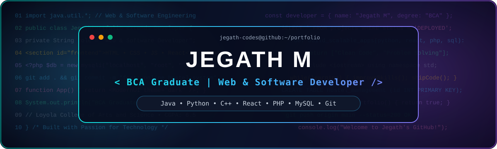

  <!-- Code-Background SVG Banner -->
  

    

  <!-- Animated Typing SVG -->
  

   

  <!-- Profile Views Counter -->
  
  
  

---

## 👨‍💻 About Me

> **Bachelor of Computer Applications (BCA)** graduate with a solid foundation in programming languages, modern web development, and database management. Seeking an entry-level **Web Developer** or **Software Developer** role to build impactful digital products and contribute effectively to organizational growth.

- 🎓 **Education:** Bachelor of Computer Applications (BCA) — **Loyola College of Arts and Science** (`2022 – 2026`, **CGPA: 6.5**)
- 🚀 **Portfolio:** [https://jegath-codes.github.io/Jegath-codes-/](https://jegath-codes.github.io/Jegath-codes-/)
- 💻 **Core Focus:** Full-Stack Web Development, Software Engineering & Database Management
- 📚 **Coursework:** Data Structures • Operating Systems • Web Development • SQL

---

## 💻 Coding Languages, Frameworks & Tools (Tech Logos)

<!-- Icon Set (Developer Logos) -->

  

<!-- Detailed Tech Badges with Logos -->

---

## 🛠️ Featured Project

### 🏢 Online Hostel Management System *(Academic Team Project)*
- Collaboratively developed an **Online Hostel Management System** as part of an academic team project to streamline hostel administration workflows.
- Contributed actively to application development, problem-solving, and module integration while ensuring effective team coordination and timely delivery.

---

## 🎓 Academic Qualification

| Qualification | Institution | Year | Score |
| :--- | :--- | :---: | :---: |
| **Bachelor of Computer Applications (BCA)** | Loyola College of Arts and Science | `2022 – 2026` | **CGPA: 6.5** |
| **HSC – 12th Standard** | Sri Ramakrishna Saradha Higher Secondary School | `2022` | — |
| **SSLC – 10th Standard** | Sri Ramakrishna Saradha Higher Secondary School | `2020` | — |

---

## 🎯 Areas of Interest

`🌐 Web Development` • `💻 Software Development` • `🗄️ Database Management` • `🧩 Problem Solving` • `🤝 Customer Relationship Management`

---

## 📊 GitHub Activity & Streak

  

---

  
   
  ⭐ Star my repositories if you like my work! • <b>JEGATH M</b>

